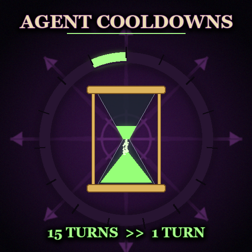

<p align="center">
  
</p>

<h1 align="center">Agent Cooldowns</h1>

<p align="center"><i>"Patience is for the weak, yes-yes!"</i></p>

<p align="center">
  <a href="LICENSE">MIT License</a>
</p>

**Stop waiting fifteen turns for the next cult.** This Total War: WARHAMMER III mod shortens the cooldowns of your agent actions: Chaos cults, the Skaven Under-Empire, Vampire Coast pirate coves and a few legendary characters' special actions. By default every covered action is ready again after **1 turn**, and the game's own cooldown counter shows that number.

| | |
|---|---|
| **Game** | Total War: WARHAMMER III, update 9.0 (Lords of the End Times) |
| **Mode** | single player; player factions only, the AI keeps vanilla cooldowns |
| **Contents** | scripts only, no database tables |
| **Save-game** | safe to add mid-campaign |
| **Settings** | optional, with the [Mod Configuration Tool](https://steamcommunity.com/sharedfiles/filedetails/?id=2927955021) |
| **Tests** | 78 automated tests (action catalogue against the game data, campaign script, MCT page, pack) |

## Covered actions

| Action | Vanilla cooldown |
|---|---|
| Establish cult (Khorne, Nurgle, Slaanesh, Tzeentch cultists) | 15 turns per cultist |
| Expand the Under-Empire (Warlock Engineer, Ghoritch) | 10 turns for the faction, shorter with the tech and Skavenblight's Shattered Tower |
| Establish pirate cove (Vampire Coast captains) | 15 turns per captain, plus 15 turns of +200% cove cost for the faction |
| Lord Kroak's strikes on a settlement and its walls | 30 / 15 turns |
| Ariel's settlement action | 30 turns |
| Glottkin: convert a lord or a garrison to Nurgle | 6 / 3 turns |

Not touched: passive Under-Empire and cult spread, Magus cults, the Changeling's trickster cults and vampire covens (they have no cooldown in vanilla), rituals and every other cooldown.

## Optional: settings (MCT)

Without the [Mod Configuration Tool](https://steamcommunity.com/sharedfiles/filedetails/?id=2927955021) every covered action uses 1 turn. With it, the **Agent Cooldowns** page has:

- **Cooldown, turns:** 0–30, default 1. 0 frees the action again on the same turn where the game allows it (faction-wide cooldowns such as the Under-Empire; an agent still needs action points).
- **Per action:** each category, and each cult god separately, has an "own value" checkbox with its own slider. For example: Slaanesh cults 1 turn, Nurgle cults the vanilla 15.

The mod only ever shortens cooldowns: a value at or above the vanilla cooldown leaves it as it is. Changing a setting mid-campaign also updates cooldowns that are already running.

## Install

Copy **`agent_cooldowns.pack`** (and its preview `agent_cooldowns.png`) into the game's `data` folder and enable it in the launcher.

Safe to add to a running campaign: cooldowns already in progress count from the moment the mod is added. The mod adds no database records, so removing it should leave saves loadable.

## Known behaviour

- When the mod is added to a running campaign, an agent already on cooldown keeps showing the vanilla number until the cooldown ends early at the configured turn (the game does not tell scripts how many turns an agent's cooldown has left).
- The Glottkin's Marks of Nurgle shorten their own conversion cooldowns; the mod's value replaces theirs, never going above the vanilla 6 / 3 turns.

## Building from source

Requires Python 3.14 and the game installed (the tests read the vanilla `db.pack`).

```bash
python -m pip install pytest lupa pillow numpy
python -m pytest
python -m tools.build
```

`python -m tools.build` writes `dist/agent_cooldowns.pack` and its Workshop preview image `dist/agent_cooldowns.png` (drawn by `tools/preview.py`). `--install` also copies both into the game's `data` folder (close the game first). Game path: `tools/paths.py`.

### How it works

- The game keeps an action's cooldown as an effect bundle that blocks the action: the engine puts it on the agent (`action_results.actor_effect_bundle`), or CA's scripts put it on the faction (the Under-Empire, pirate cove cost).
- `tools/categories.py` lists the covered actions, their cooldown bundles and vanilla turns; tests check every key and turn count against the game's tables.
- `src/script/campaign/mod/agentcd.lua` listens for successful agent actions of human factions, re-applies the cooldown bundle with the configured turns (never longer than vanilla) and removes it at the start of the player's turn once those turns have passed. Its state is saved with the campaign. Tested through `lupa` against a mock of the campaign API (`tests/lua/mock_game.lua`).
- `src/script/mct/settings/agentcd.lua` is the optional MCT page, with English and Russian texts from `tools/texts.py`.
- The game's Lua does not support the `plain` argument of `string.find` (calling it crashes the game); `tests/test_game_lua_compat.py` keeps it out of the scripts.

## Credits

- [RPFM](https://github.com/Frodo45127/rpfm) and its [schemas](https://github.com/Frodo45127/rpfm-schemas) by Frodo45127. The table layouts in `schemas/` come from there.
- Groove Wizard, for the [Mod Configuration Tool](https://steamcommunity.com/sharedfiles/filedetails/?id=2927955021).

## License

The mod's code, scripts and texts are released under the [MIT License](LICENSE) © 2026 Skylar92. Total War: WARHAMMER III and its game data, art and mechanics belong to Creative Assembly and Games Workshop; this is an unofficial fan mod and is not endorsed by them.
